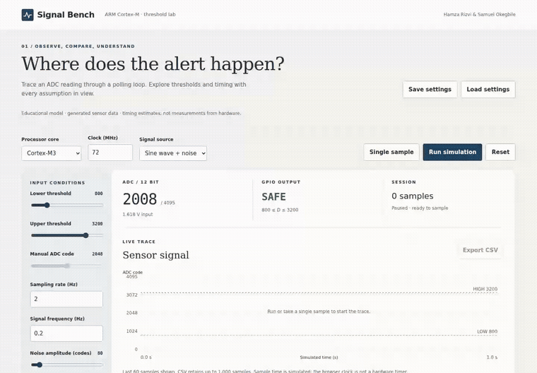

# Vibecode Projects

Two independent tools: an ARM sensor teaching lab and an offline Python knowledge library. Each has its own runtime; neither needs an external API or cloud database.

| Project          | Purpose                                                                           | Start                                          |
| ---------------- | --------------------------------------------------------------------------------- | ---------------------------------------------- |
| **Signal Bench** | Model ADC thresholds, trace a Thumb-like polling path, compare timing assumptions | `python3 scripts/serve.py`                     |
| **REMNANT**      | Search a local knowledge library and track community skill prerequisites          | See [REMNANT setup](remnant-project/README.md) |

## Demo



[Watch the full simulator video](docs/assets/signal-bench-demo.mp4) · [Read the REMNANT CLI walkthrough](docs/assets/remnant-demo.txt)

The recording shows the actual local simulator with generated sensor data: capture, high/low alerts, core comparison, and CSV export. It does not show real hardware measurements.

## Signal Bench

ARM simulator authors: **Hamza Rizvi & Samuel Okegbile**.

```sh
git clone https://github.com/Hazmat-ai/Vibecode_projects.git
cd Vibecode_projects
python3 scripts/serve.py
```

Open **http://127.0.0.1:3000**. No npm install or internet connection is needed to run it. JavaScript modules require HTTP; double-clicking `simulator.html` is no longer the supported launch method. The local preview server intentionally exposes only the simulator files and binds to loopback.

1. Select a Cortex core and a clock. Default clocks are example settings, not maximum processor specifications.
2. Select a sine wave or manual ADC input. Adjust the inclusive lower and upper thresholds.
3. Run continuously, pause, or take a single sample. The executed instruction path is highlighted.
4. Export a CSV capture or save/load validated settings. Seeded noise is repeatable after reset with the same configuration.

Features include a responsive instrument-style layout, self-hosted SVG plots, explicit timing assumptions, 12 equation notes, keyboard controls, accessible form labels, and bounded in-memory capture storage. No fonts, charts, analytics, or scripts load from third-party CDNs.

### What the model means

This is an educational simulator, **not an ARM emulator, real ADC interface, or hardware benchmark**. It distinguishes executed instructions from modeled cycles, includes configurable load/store/branch costs, and labels exception-entry reference values with their assumptions. Busy polling is not treated as idle CPU time. No fabricated OS memory percentages, RTOS scheduler costs, current measurements, efficiency scores, or power comparisons are shown.

See [model definitions and references](docs/simulator-model.md). Validate any real-time or power conclusion on the target MCU using its vendor documentation and measurements.

## REMNANT

The former `APP2.zip` source is now available under [`remnant-project/`](remnant-project/). Generated databases, WAL files, macOS metadata, and duplicate compressed source are excluded from the current source tree. Original versions remain in Git history.

REMNANT remains a terminal application. It has no network calls, server, web API, user accounts, or mandatory third-party packages. Its local database supports validated imports, FTS search, community prerequisites, conflict tracking, atomic merges, and online SQLite backups. The bundled three articles and six skills are example content, not a reviewed field knowledge base.

## Development checks

Node 24 or 25 and Python 3.8+ are supported for development; a current supported Python release is recommended for actual use.

```sh
npm ci
npm test
npm run test:python
npx playwright install --with-deps chromium
npm run test:e2e
npm run format:check
npm audit
```

Python tests also run without site packages:

```sh
python3 -S -m unittest discover -s remnant-project/remnant/tests -v
```

CI checks the simulator at desktop/mobile widths and runs REMNANT tests on Python 3.8, 3.12, and 3.14. Local verification does not imply every CI matrix version or container image has been tested locally.

## Deployment and maintenance

Only publish `simulator.html` and the `simulator/` directory to a static host. Set `simulator.html` as the index, or copy it to `index.html`. Keep REMNANT databases and repository metadata out of the web root. An optional non-root Nginx container is provided:

```sh
docker build -t signal-bench .
docker run --rm -p 127.0.0.1:8080:8080 signal-bench
```

Use HTTPS at your public hosting edge. The Python server is a local development preview, not a public production service. See [security and release notes](docs/security-and-release.md).
